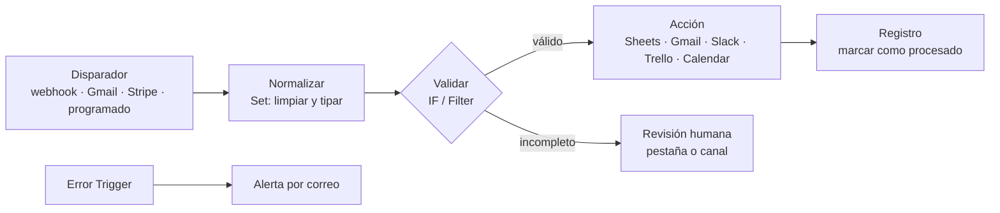

# Hackatón n8n: Nodo Cero

**Quince automatizaciones listas para construir en n8n Cloud, pensadas para emprendedores que quieren recuperar horas sin contratar a nadie.**

Proyecto para la **Hackatón n8n: Nodo Cero** · Creado por **Jhon angelo / Speaker Tech** · Licencia MIT

Cada automatización tiene su propia carpeta con una guía que cubre el proceso completo: qué resuelve, cómo funciona, cómo construirla a mano, cómo pedir su construcción a la IA de n8n Cloud, qué conectar, cómo probarla y qué riesgos revisar.

> Este repositorio contiene solo guías y prompts. No incluye credenciales, IDs reales ni datos personales. Todo valor que debes reemplazar empieza con `PEGAR_`.

---

## Para quién es

- Emprendedores y dueños de negocios pequeños sin equipo técnico.
- Freelancers y consultores con clientes, cobros y citas.
- Equipos de 1 a 10 personas que ya usan Gmail, Google Sheets, Slack o Stripe.

No necesitas programar. Sí necesitas una cuenta de n8n Cloud y acceso a las herramientas que cada guía indica.

## Catálogo

Las automatizaciones se agrupan por área de negocio.

### Ventas y leads

| # | Automatización | Resultado | Disparador |
|---|---|---|---|
| 01 | [Captura de leads](automatizaciones/01-captura-de-leads/) | Cada formulario queda en una hoja, avisa al equipo y recibe bienvenida | Webhook |
| 15 | [Prospección con lista propia](automatizaciones/15-prospeccion-lista-propia/) | Contacto diario limitado, solo a quien dio consentimiento, con baja | Programado (días hábiles) |

### Finanzas

| # | Automatización | Resultado | Disparador |
|---|---|---|---|
| 03 | [Recordatorio de facturas vencidas](automatizaciones/03-recordatorio-facturas/) | Cobros recordados a tiempo, sin perseguir uno por uno | Programado (diario) |
| 04 | [Comprobante de pedido](automatizaciones/04-comprobante-pedido/) | Pedido registrado y comprobante enviado; no sustituye la factura fiscal | Webhook |
| 05 | [Extracción de facturas PDF](automatizaciones/05-extraccion-facturas-pdf/) | Datos de facturas de proveedores llegan a una hoja de gastos | Gmail con PDF |
| 06 | [Avisos de pagos Stripe](automatizaciones/06-pagos-stripe/) | Pagos registrados; cobro fallido dispara aviso al cliente | Stripe |
| 12 | [Gastos desde recibos](automatizaciones/12-gastos-recibos/) | Recibos del correo quedan clasificados por categoría | Gmail con asunto "recibo" |

### Operación y clientes

| # | Automatización | Resultado | Disparador |
|---|---|---|---|
| 07 | [Onboarding de cliente](automatizaciones/07-onboarding-cliente/) | Tras el pago: carpeta, brief y tarea de arranque | Stripe |
| 13 | [Atención al cliente con IA](automatizaciones/13-atencion-cliente-ia/) | Tickets clasificados y borradores listos para revisar | Webhook |
| 14 | [Agenda de citas](automatizaciones/14-agenda-citas/) | Cita en calendario, confirmación y recordatorio 24 horas antes | Webhook |
| 10 | [Notas de reunión a tareas](automatizaciones/10-notas-reunion-tareas/) | Acuerdos de la reunión convertidos en tarjetas con responsable y fecha | Webhook |

### Contenido y análisis

| # | Automatización | Resultado | Disparador |
|---|---|---|---|
| 02 | [Triaje de correos con IA](automatizaciones/02-triaje-de-correos-ia/) | Correos ordenados; clientes reciben borrador, urgentes se avisan | Gmail (correo nuevo) |
| 08 | [Publicación en LinkedIn](automatizaciones/08-publicacion-linkedin/) | Posts publicados en la fecha indicada desde una hoja | Programado (cada hora) |
| 09 | [Newsletter semanal desde RSS](automatizaciones/09-newsletter-rss/) | Un correo semanal con los artículos recientes de tus fuentes | Programado (semanal) |
| 11 | [Reporte semanal con IA](automatizaciones/11-reporte-semanal-ia/) | Resumen de métricas que no inventa cifras | Programado (semanal) |

## Arquitectura de referencia

Casi todas las automatizaciones siguen el mismo patrón. Aprender este patrón una vez te sirve para las quince.



Si una automatización usa IA, el modelo se ubica en el paso de clasificación o redacción. Su salida se valida antes de actuar.

## Principios de diseño

Estos principios aplican a todos los flujos del repositorio.

1. **Validar antes de actuar.** Ningún flujo escribe, envía o cobra sin revisar que los datos estén completos.
2. **La IA propone, el flujo valida.** Salidas de modelos de lenguaje se leen en formato JSON con un nodo de código que tolera errores. Si el formato no sirve, el flujo se detiene sin actuar.
3. **Sin envíos automáticos sensibles.** La IA redacta borradores. Una persona aprueba cualquier respuesta a un cliente.
4. **Un fallo no tumba el resto.** Los pasos externos usan *continue on fail* y cada flujo tiene su propia alerta por correo.
5. **No procesar dos veces.** Los correos se marcan como leídos. Las filas se marcan como publicadas, contactadas o registradas.
6. **Prueba antes de producción.** Stripe en modo de prueba. Hojas de ejemplo. Destinatarios propios en las primeras corridas.
7. **Mínimo privilegio.** Cada flujo pide solo las credenciales que necesita.

## Stack

| Capa | Herramientas |
|---|---|
| Orquestación | n8n Cloud |
| Datos | Google Sheets, Google Drive, Trello |
| Comunicación | Gmail, Slack, LinkedIn |
| Pagos y calendario | Stripe, Google Calendar |
| Inteligencia | DeepSeek chat (créditos de IA de n8n Cloud o clave propia) |

## Quick start

| Paso | Qué hacer | Tiempo estimado |
|---|---|---|
| 1 | Crea tu cuenta de n8n Cloud y conecta Gmail y Google Sheets | 15 min |
| 2 | Abre la carpeta de [01 Captura de leads](automatizaciones/01-captura-de-leads/) y construye el flujo | 1 a 2 h |
| 3 | Reemplaza los valores `PEGAR_`, prueba con datos de ejemplo y activa | 30 min |

Después de tu primera automatización, sigue con [03 Recordatorio de facturas](automatizaciones/03-recordatorio-facturas/). Usa el mismo patrón con otra fuente de datos.

## Antes de activar cualquier flujo

| Área | Regla |
|---|---|
| Correo y spam | Escribe solo a quien dio consentimiento o tiene relación comercial. Incluye baja. Revisa la ley de tu país (LFPDPPP en México, RGPD en la UE). |
| Facturación | Los flujos envían comprobantes, no CFDI. La factura fiscal la emite tu sistema o tu contador. |
| IA | Revisa las primeras salidas antes de dejar un flujo correr solo. |
| Pagos | Stripe en modo de prueba hasta validar todo. |
| Secretos | Claves y tokens viven en las credenciales de n8n, nunca en hojas, prompts ni repositorios. |

## Estructura del repositorio

```
.
├── README.md
└── automatizaciones/
    ├── 01-captura-de-leads/README.md
    ├── 02-triaje-de-correos-ia/README.md
    ├── 03-recordatorio-facturas/README.md
    ├── 04-comprobante-pedido/README.md
    ├── 05-extraccion-facturas-pdf/README.md
    ├── 06-pagos-stripe/README.md
    ├── 07-onboarding-cliente/README.md
    ├── 08-publicacion-linkedin/README.md
    ├── 09-newsletter-rss/README.md
    ├── 10-notas-reunion-tareas/README.md
    ├── 11-reporte-semanal-ia/README.md
    ├── 12-gastos-recibos/README.md
    ├── 13-atencion-cliente-ia/README.md
    ├── 14-agenda-citas/README.md
    └── 15-prospeccion-lista-propia/README.md
```

Cada guía sigue la misma plantilla: para qué sirve, proceso, piezas, antes de empezar, construcción a mano, construcción con IA, credenciales, pruebas, riesgos.

## Flujos en n8n Cloud

Cada automatización tiene su flujo publicado como borrador en n8n Cloud. Los enlaces abren el flujo en la instancia del autor; necesitas acceso para verlos.

| # | Flujo | Enlace |
|---|---|---|
| 01 | Captura de leads a Sheets, Slack y bienvenida | [Abrir](https://jhoncito23.app.n8n.cloud/workflow/PCZzfUDRj7lmtXdd) |
| 02 | Triaje de correos con IA: cliente, urgente u otro | [Abrir](https://jhoncito23.app.n8n.cloud/workflow/x6yKIhJn6zElu330) |
| 03 | Recordatorio automático de facturas vencidas | [Abrir](https://jhoncito23.app.n8n.cloud/workflow/DJSiwwpW62t2Ao2U) |
| 04 | Comprobante de pedido desde formulario | [Abrir](https://jhoncito23.app.n8n.cloud/workflow/Qy6HzbdNtPVGvwVs) |
| 05 | Extracción de datos de facturas PDF a Gastos | [Abrir](https://jhoncito23.app.n8n.cloud/workflow/EtzinQWVEJeFyDHm) |
| 06 | Avisos de pagos Stripe: exitoso y fallido | [Abrir](https://jhoncito23.app.n8n.cloud/workflow/p2Gyql3UC6aV9Ua9) |
| 07 | Onboarding de cliente tras pago: Drive, brief y Trello | [Abrir](https://jhoncito23.app.n8n.cloud/workflow/uTmZ5SkgjJ1qAV1c) |
| 08 | Publicación programada en LinkedIn desde hoja | [Abrir](https://jhoncito23.app.n8n.cloud/workflow/Qf2bwJoRrbrHYpjp) |
| 09 | Newsletter semanal desde RSS | [Abrir](https://jhoncito23.app.n8n.cloud/workflow/vw5602XFtOM74qaF) |
| 10 | Notas de reunión a tareas en Trello con IA | [Abrir](https://jhoncito23.app.n8n.cloud/workflow/evqlFdK8CPMWfym5) |
| 11 | Reporte semanal de métricas con resumen IA | [Abrir](https://jhoncito23.app.n8n.cloud/workflow/edVZqoT7mUSYKg3W) |
| 12 | Registro de gastos desde recibos por correo | [Abrir](https://jhoncito23.app.n8n.cloud/workflow/RuX7avIZEzhzStb9) |
| 13 | Atención al cliente: clasificación y borrador con IA | [Abrir](https://jhoncito23.app.n8n.cloud/workflow/2pVYTtrTAdWUaOZq) |
| 14 | Agenda de citas con confirmación y recordatorio | [Abrir](https://jhoncito23.app.n8n.cloud/workflow/0PjvBLwlM0IACxS3) |
| 15 | Prospección con lista propia y opción de baja | [Abrir](https://jhoncito23.app.n8n.cloud/workflow/H0JXPKJXzVhcpwdu) |

## Estado y limitaciones

- Los flujos están diseñados y validados como borradores en n8n Cloud. Aún no se han probado de punta a punta en producción.
- Los tiempos son estimados para una primera construcción.
- LinkedIn exige una app aprobada y su token caduca cada 60 días.
- Dos guías (05 y 12) leen texto del PDF o del correo. Los escaneos sin texto no se procesan.
- Los modelos de IA pueden equivocarse. Por eso cada flujo valida o deja revisión humana.

## Hoja de ruta

- Probar cada flujo de punta a punta con cuentas de prueba y publicar resultados.
- Agregar deduplicación por id en los flujos de pagos y leads.
- Agregar resumen con IA a la newsletter (09).
- Conectar transcripciones de Zoom o Meet como disparador para la guía 10.
- Versionar los flujos exportados en JSON, sin credenciales ni IDs.

## Contribuir

Abre un issue con el caso de uso antes de enviar cambios. Cada automatización nueva debe incluir su carpeta con la plantilla completa, validación de datos, manejo de errores y una sección de riesgos.

## Autor

**Jhon angelo / Speaker Tech**, para la Hackatón n8n: Nodo Cero.

## Licencia

MIT. Ver [LICENSE](LICENSE).
